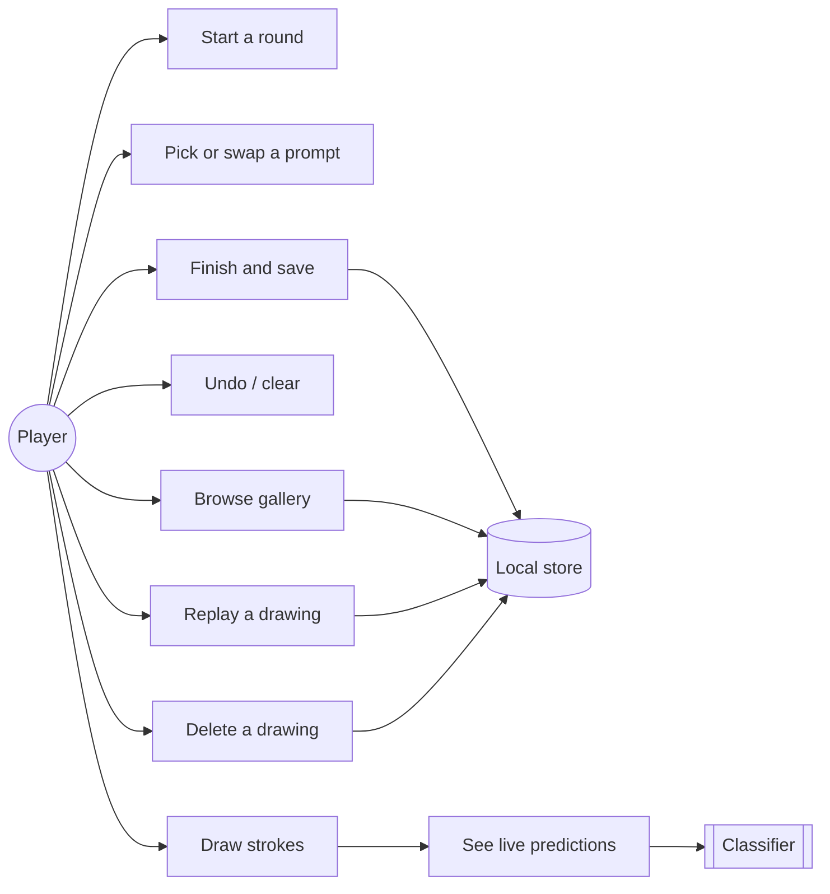
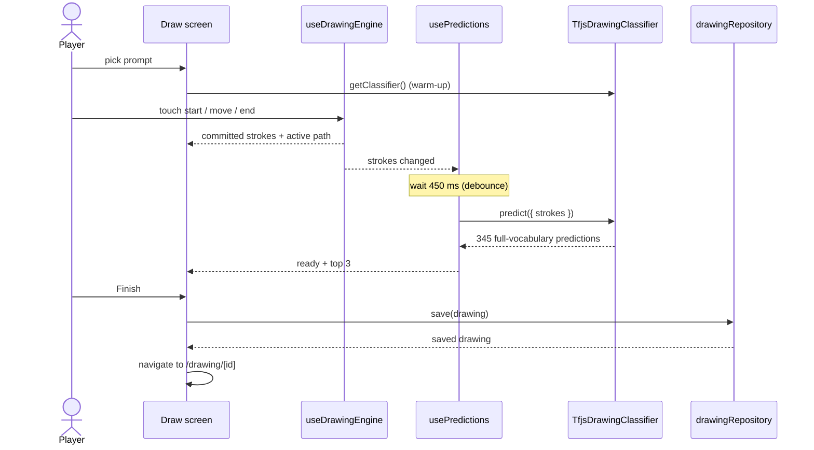
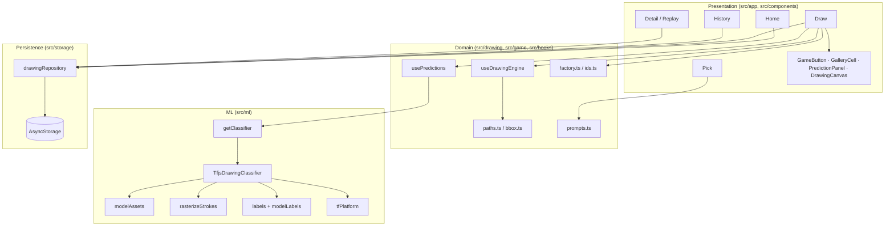
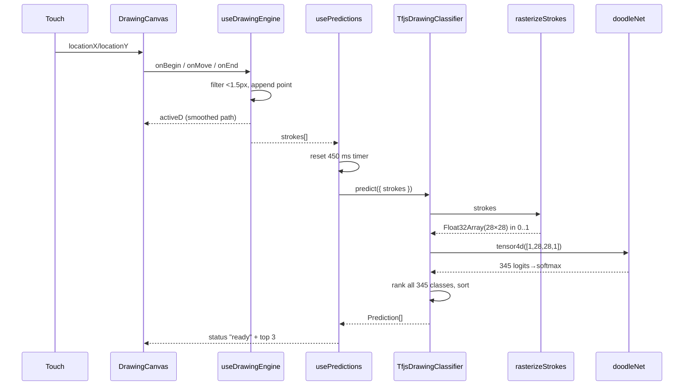
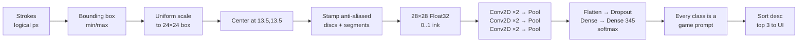
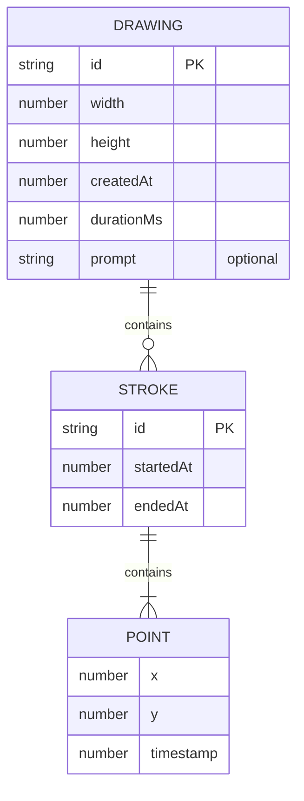

# Bad Artist — Project Documentation

> A drawing game where you sketch a prompt and a neural network tries to guess it.
> Everything runs on the device: no server, no account, no network at play time.

**Document version:** 1.0
**App version:** 1.0.0 (`app.json`)
**Repository:** `thebadartist`
**Platforms:** iOS, Android (Expo Go / development build), Web (React Native Web)

---

## Table of Contents

1. [Introduction](#1-introduction)
2. [Problem Statement](#2-problem-statement)
3. [Proposed Solution](#3-proposed-solution)
4. [Objectives](#4-objectives)
5. [Scope](#5-scope)
6. [Requirements](#6-requirements)
7. [Use Case](#7-use-case)
8. [Functional Requirements](#8-functional-requirements)
9. [Non-Functional Requirements](#9-non-functional-requirements)
10. [Technology Stack](#10-technology-stack)
11. [System Architecture](#11-system-architecture)
12. [Database Design](#12-database-design)
13. [Core Logic](#13-core-logic)
14. [Deployment Details](#14-deployment-details)

---

## 1. Introduction

**Bad Artist** is a mobile drawing game built with Expo and React Native. A round works like this:

1. The app deals you a prompt ("Draw a cat", "Draw an apple", …).
2. You draw it with your finger on a blank canvas.
3. While you draw, a convolutional neural network looks at the sketch and shows its top three guesses, updated live.
4. When you tap **Finish**, the sketch is saved locally and you can watch a chronological replay of how it was drawn.

The project is deliberately *not* a tutorial clone of Google's Quick, Draw!. It is a complete, self-contained mobile product with:

- A vector-first drawing pipeline (strokes are stored as data, never as screenshots).
- A real machine-learning inference path that ships a pretrained model inside the app bundle.
- A local gallery, replay player, undo, delete, and prompt-swapping loop.
- A hand-built editorial design system (paper background, near-black ink, one orange accent).

The app exists to demonstrate that meaningful on-device machine learning is possible in a **pure JavaScript / Expo Go** environment — without Xcode, Android Studio, a custom native module, or a model server.

---

## 2. Problem Statement

Building a sketch-recognition drawing game on mobile presents four concrete problems.

### 2.1 Constraints of the development environment

The primary development machine runs **Linux**, and the only physical test device is an **iPhone**. That rules out:

- Xcode and the iOS Simulator (macOS only).
- Building a custom native binary locally.
- Any library whose iOS support requires a hand-written native module that Expo Go does not bundle.

The project must therefore run inside **Expo Go** over Metro, which means **JavaScript/TypeScript only** for the ML path.

### 2.2 Most good sketch models are not usable in Expo Go

The natural choice for sketch recognition is Google's Quick, Draw! data and a small CNN. However:

- Many state-of-the-art sketch classifiers are distributed as **TensorFlow Lite** assets. TFLite requires a native interpreter (`react-native-fast-tflite` or similar) that is not present in Expo Go.
- Python/PyTorch checkpoints require a server or an on-device runtime that Expo does not provide.
- Training a model from scratch on-device is not feasible at this scale.

The project therefore needs a **pretrained model already in TensorFlow.js layers-model format**, small enough to bundle and fast enough to run on a CPU backend in JavaScript.

### 2.3 The game needs instant, believable feedback

A drawing game lives or dies on feedback latency. If predictions lag by seconds, or flicker between classes while the user is mid-stroke, the experience feels broken. Inference must be:

- Fast enough to feel live (tens of milliseconds, not hundreds).
- Debounced so it does not run on every touch event.
- Cancellable so stale results never overwrite newer ones.

### 2.4 Data ownership and offline play

Users expect a drawing app to work on a plane. Sending private doodles to a cloud endpoint would add:

- A backend to build, pay for, and secure.
- Network latency and failure modes.
- Privacy concerns around user-created content.

The app must work **fully offline** and keep all drawings **on the device**.

### 2.5 UI quality problem

Many student ML demos are a canvas plus a raw probability table. The product goal is a *game*: a clear loop (pick → draw → finish → replay), a cohesive visual identity, and controls that feel physical (chunky buttons with press animation and haptics). This is a real requirement, not polish — it is what makes the project presentable.

---

## 3. Proposed Solution

The solution has five parts.

### 3.1 On-device model, bundled as an asset

Ship `yining1023/doodleNet` — a Keras CNN converted to a TensorFlow.js **layers-model** — directly inside the app bundle:

| Artifact | Size | Purpose |
| --- | --- | --- |
| `assets/ml/doodlenet/model.json` | ~8 KB | Topology + weight manifest |
| `assets/ml/doodlenet/group1-shard1of1.bin` | 2,176,804 bytes | Float32 weights |
| `assets/ml/doodlenet/class_names.txt` | 345 lines | Class labels in model index order |

At runtime the app loads the artifacts through `expo-asset` + `expo-file-system` and reconstructs an `io.ModelArtifacts` object. No `fetch()` of model files, no CDN, no inference server.

### 3.2 Deterministic stroke rasterization

Raw strokes (a list of `{x, y, timestamp}` points) are converted to the exact input format the model was trained on: a **28×28 grayscale ink grid, white ink on black**, with the drawing's bounding box scaled to fit and centered, aspect ratio preserved. This reproduces the Quick, Draw! bitmap convention that the model expects.

### 3.3 Full 345-class vocabulary

The model's class list and the game's prompt list are the same **345 Quick, Draw! categories**. Every prompt a player can be given is a class the model was trained on, so no prediction is discarded or remapped:

1. Reads all 345 softmax outputs.
2. Maps prompt index `i` directly to model index `i` (both lists are generated from the same file, in the same order).
3. Sorts all 345 candidates and shows the top three.

The Node harness still reports "restricted" numbers, where the softmax is renormalized over only the 24 classes that have cached validation samples. That keeps results comparable with earlier runs; the game itself displays raw, full-vocabulary probabilities.

### 3.4 Debounced, generation-guarded live inference

A `usePredictions` hook runs inference **450 ms after the last stroke change**. Each run carries a monotonically increasing generation number; results from an older generation are discarded. Inference is wrapped in `tf.tidy()` so intermediate tensors are freed.

### 3.5 Local-first product architecture

- **Storage:** a single AsyncStorage document (`badartist.drawings.v1`) holding an array of drawings.
- **Rendering:** stored strokes are re-rendered as SVG paths everywhere (canvas, gallery tiles, replay). No screenshots, no image files.
- **Replay:** a requestAnimationFrame loop replays the recorded timestamps, so the user literally watches their own hand movements again.

---

## 4. Objectives

### 4.1 Primary objectives

| ID | Objective |
| --- | --- |
| O1 | Let a user pick a prompt, draw it, and save the result. |
| O2 | Predict the drawn class on-device with no network dependency. |
| O3 | Show the top three predictions live, with the correct prompt highlighted. |
| O4 | Persist drawings and let the user browse, replay, and delete them. |
| O5 | Run in Expo Go on a physical iPhone (no native build step). |

### 4.2 Secondary objectives

| ID | Objective |
| --- | --- |
| O6 | Keep the raw stroke data as the single source of truth (future-proof for better models). |
| O7 | Provide a reproducible accuracy harness for the model + preprocessing pipeline. |
| O8 | Deliver a coherent, tactile UI rather than a raw demo screen. |
| O9 | Support web as a secondary target for quick iteration. |

### 4.3 Learning objectives

- Understand the full lifecycle of a small ML feature: asset acquisition → preprocessing → inference → UX integration → measurement.
- Practise the **seam/interface** pattern (`DrawingClassifier`) so the ML backend can be swapped without touching screens.
- Learn why data-shape and label-order bugs are the most common failure mode in ML integration, and how to test against real data rather than intuition.

---

## 5. Scope

### 5.1 In scope

- Single-player drawing game loop: home → pick prompt → draw → save → detail/replay.
- 345-prompt vocabulary: the model's full Quick, Draw! class list.
- Live on-device classification with a bundled pretrained CNN.
- Local drawing gallery grouped by day, with delete.
- Undo, clear, prompt swap, and finish controls.
- Chronological replay with play/pause/restart.
- Consistent editorial design system with haptics and press animation.
- Web build for development convenience.
- Reproduction scripts for model assets and accuracy evaluation.

### 5.2 Out of scope

- Multiplayer, accounts, cloud sync, leaderboards.
- A scoring system or win/lose condition (the panel reports the model's guess; it does not adjudicate).
- Training or fine-tuning on the device.
- Photo import, camera, or image-based input.
- Android/iOS store submission (no signed production builds configured).
- Localization.
- Server-side inference or analytics.
- Accessibility beyond labels and a polite live region (full screen-reader flow is not audited).

### 5.3 Assumptions

- The device has enough memory to hold a ~2.2 MB weight buffer and a TensorFlow.js CPU backend.
- The user draws with one finger on a portrait phone.
- The prompt vocabulary stays a subset of the model's 345 classes.

### 5.4 Limitations (current)

- Predictions can be confidently wrong; the UI presents them as guesses, not verdicts.
- `eslint-config-expo` is pinned to `~57.0.2` while the rest of the stack is SDK 58; the config still works, but versions are not fully aligned.
- The TensorFlow.js platform shim (`installTfPlatform`) also runs on web, where it overwrites the existing browser platform and logs a warning (harmless).
- Expo Go on the test device must match the project's SDK 58; a mismatched Expo Go produces native-module errors before any app code runs.

---

## 6. Requirements

### 6.1 Hardware requirements

| Environment | Minimum |
| --- | --- |
| Development machine | 4-core CPU, 8 GB RAM, ~1 GB free for `node_modules`, internet for first install |
| iPhone (Expo Go) | Any device supported by the installed Expo Go release (iOS 16+ recommended) |
| Android (optional) | API 24+ with a matching Expo Go |
| Web (optional) | Modern browser with WebGL/WASM-capable CPU fallback |

### 6.2 Software requirements

| Software | Version used |
| --- | --- |
| Node.js | 20+ (LTS) |
| npm | 10+ |
| Expo SDK | 58 (`expo ^58.0.25`) |
| React Native | 0.88.1 |
| React | 19.3.0 |
| TypeScript | ~6.0.3 |
| Expo Go | Must match SDK 58 |
| TensorFlow.js | 4.22.0 (`core`, `layers`, `backend-cpu`) |

### 6.3 Development setup

```bash
# 1. Install JavaScript dependencies
npm install

# 2. Start Metro
npx expo start

# 3. Scan the QR code with Expo Go (same SDK version)

# Quality gates
npx tsc --noEmit     # typecheck
npx expo lint        # lint

# Model tooling (optional, needs network once)
npm run ml:fetch     # download model + validation samples into .ml-cache/
npm run ml:accuracy  # reproduce the accuracy numbers
```

### 6.4 Project structure

```
thebadartist/
├── app.json                     Expo config (routes, splash, experiments)
├── metro.config.js              Adds .bin to assetExts so weights can be bundled
├── package.json                 Dependencies + ml:* scripts
├── tsconfig.json                Strict TS, @/* path alias, node types
├── assets/
│   ├── images/                  Icons, splash, favicon
│   └── ml/doodlenet/            model.json, weights shard, class_names.txt
├── scripts/
│   ├── ml/fetch-assets.mjs      Downloads model + Quick, Draw! samples
│   ├── ml/accuracy.ts           Node accuracy harness
│   ├── ml/gen-labels.mjs        Regenerates src/ml/modelLabels.ts
│   └── reset-project.js         Expo template helper (unused in the game)
└── src/
    ├── app/                     Expo Router screens (file-based routes)
    │   ├── _layout.tsx          Stack navigator + splash handling
    │   ├── index.tsx            Home: masthead, start button, recent drawings
    │   ├── pick.tsx             Choose one of three prompts
    │   ├── draw.tsx             Canvas + live predictions + finish
    │   ├── history.tsx          Gallery grouped by day
    │   └── drawing/[id].tsx     Detail + replay + delete
    ├── components/              DrawingCanvas, DrawingPreview, ReplayCanvas,
    │                            GalleryCell, GameButton, PredictionPanel
    ├── constants/theme.ts       Palette + Spacing tokens
    ├── drawing/                 bbox.ts, paths.ts, factory.ts, ids.ts
    ├── game/prompts.ts          All 345 prompts + selection/display helpers
    ├── hooks/                   useDrawingEngine, usePredictions
    ├── ml/                      classifier, assets, labels, preprocessing
    ├── storage/                 drawingRepository (AsyncStorage)
    └── types/                   drawing.ts (data model + classifier contract)
```

---

## 7. Use Case

### 7.1 Actors

| Actor | Description |
| --- | --- |
| **Player** | The human using the app. |
| **Classifier** | The on-device TensorFlow.js model. |
| **Local store** | AsyncStorage repository (`drawingRepository`). |

### 7.2 Use case diagram



### 7.3 Primary use case: play one round

| Field | Value |
| --- | --- |
| **Name** | Play a drawing round |
| **Actor** | Player (with Classifier and Local store as supporting actors) |
| **Precondition** | App is installed; storage may be empty. |
| **Trigger** | Player taps **Start drawing**. |

**Main success scenario**

1. Player taps **Start drawing** on the home screen.
2. System shows three distinct prompts.
3. Player picks one; the draw screen opens with the challenge title (e.g. "Draw a Cat").
4. The classifier begins loading in the background (if not already warm).
5. Player draws one or more strokes. Each stroke is captured as raw points.
6. Every 450 ms of inactivity, the classifier rasterizes the strokes and returns 345 probabilities; the panel shows the top three.
7. Player taps **Finish**. System builds a `Drawing` (canvas size, strokes, duration, prompt) and saves it.
8. System navigates to the drawing detail screen and auto-plays a chronological replay.

**Postcondition:** one new `Drawing` exists in local storage; the gallery and home "recent" list include it.

### 7.4 Alternate flows

| ID | Flow | Handling |
| --- | --- | --- |
| A1 | Player taps **Shuffle** while choosing | Three new distinct prompts replace the trio. |
| A2 | Player taps **↻ New** before drawing | Prompt is replaced instantly, canvas untouched. |
| A3 | Player taps **↻ New** after drawing | Confirmation dialog; on confirm, canvas is cleared and prompt replaced. |
| A4 | Player taps **Clear** | Confirmation dialog; strokes are removed. |
| A5 | Player taps **Undo** | Last committed stroke is removed. |
| A6 | Classifier fails to load | Panel shows "offline" and a neutral message; drawing and saving still work. |
| A7 | Player opens a deleted/missing drawing | Detail screen shows "This drawing no longer exists." |
| A8 | Player deletes a drawing | Destructive confirmation; on confirm, record is removed and the gallery replaces the screen. |
| A9 | Player opens the app with saved drawings | Home shows the four most recent tiles and a total count. |

### 7.5 Activity flow (draw screen)



---

## 8. Functional Requirements

Each requirement is traceable to the module that implements it.

### 8.1 Navigation and screens

| ID | Requirement | Implementation |
| --- | --- | --- |
| FR-1 | The app shall open on a home screen with a start action and up to four recent drawings. | `src/app/index.tsx` |
| FR-2 | The home screen shall show the total number of saved drawings and link to the full gallery. | `src/app/index.tsx`, `src/app/history.tsx` |
| FR-3 | The app shall present exactly three distinct prompts per round and allow reshuffling. | `src/app/pick.tsx`, `pickThree()` |
| FR-4 | Selecting a prompt shall open the draw screen with that prompt in the route params. | `src/app/pick.tsx`, `src/app/draw.tsx` |
| FR-5 | The draw screen shall reject unknown or missing prompts and redirect to the picker. | `isPromptLabel()`, `router.replace('/pick')` |
| FR-6 | The gallery shall group drawings by day (Today, Yesterday, or localized date). | `dayLabel()` in `src/app/history.tsx` |
| FR-7 | The detail screen shall render the stored drawing, its prompt, date, stroke/point counts, duration, and canvas size. | `src/app/drawing/[id].tsx` |
| FR-8 | The detail screen shall offer chronological replay with Play/Replay and Restart. | `src/components/ReplayCanvas.tsx` |

### 8.2 Drawing capture

| ID | Requirement | Implementation |
| --- | --- | --- |
| FR-9 | The canvas shall capture touch coordinates relative to the canvas view. | `DrawingCanvas` (`locationX/locationY`) |
| FR-10 | Each stroke shall record ordered points with timestamps, plus start/end times. | `useDrawingEngine.beginStroke/appendPoint/endStroke` |
| FR-11 | Samples closer than 1.5 logical pixels shall be dropped, keeping the tail timestamp fresh. | `MIN_POINT_DISTANCE` |
| FR-12 | The in-progress stroke shall render as a smooth path while drawing. | `pointsToSmoothPath()`, `activeD` |
| FR-13 | The player shall be able to undo the last stroke. | `undo()` |
| FR-14 | The player shall be able to clear the canvas after confirmation. | `clear()`, `Alert` |
| FR-15 | The player shall be able to swap prompts; swapping after drawing requires confirmation and clears the canvas. | `swapPrompt()` |

### 8.3 Machine learning

| ID | Requirement | Implementation |
| --- | --- | --- |
| FR-16 | The app shall load a bundled 345-class model with no network request. | `modelAssets.ts`, `TfjsDrawingClassifier.create()` |
| FR-17 | The classifier shall validate the model's input (28×28) and output (345) shapes at load time. | `TfjsDrawingClassifier.create()` |
| FR-18 | Strokes shall be rasterized to a 28×28 ink grid using bbox fit, aspect preservation, and centering. | `rasterizeStrokes()` |
| FR-19 | Inference shall rank all 345 model classes; prompt index `i` maps to model class `i`. | `labels.ts`, `promptDisplay` |
| FR-20 | Predictions shall be returned sorted by descending confidence. | `predict()` |
| FR-21 | The draw screen shall display the top three predictions with percentages and bars. | `PredictionPanel` |
| FR-22 | The target prompt shall be visually distinguished when present in the top three. | `isTarget` styling |
| FR-23 | Inference shall be debounced by 450 ms and stale results discarded. | `usePredictions()` |
| FR-24 | The model shall warm up once at startup to avoid a slow first prediction. | `warmUp()`, draw-screen effect |
| FR-25 | A deterministic mock classifier shall be selectable via `EXPO_PUBLIC_ML_MOCK=1`. | `MockDrawingClassifier`, `ml/index.ts` |

### 8.4 Persistence and replay

| ID | Requirement | Implementation |
| --- | --- | --- |
| FR-26 | Saving shall round canvas dimensions and compute wall-clock duration. | `createDrawing()` |
| FR-27 | Drawings shall be persisted under the key `badartist.drawings.v1`. | `drawingRepository` |
| FR-28 | Newly saved drawings shall appear first in reads. | `save()` prepends; `getDrawings()` sorts desc |
| FR-29 | Reads shall be defensive: corrupt JSON or a non-array document yields an empty list. | `readAll()` |
| FR-30 | A drawing shall be retrievable by id and deletable by id. | `getDrawing()`, `deleteDrawing()` |
| FR-31 | Replay shall honor recorded timing, capped to 1.2–12 seconds. | `ReplayCanvas` timeline |
| FR-32 | Gallery tiles shall frame artwork with a zoom cap so tiny doodles are not cropped. | `frameViewBox()` |

### 8.5 UX and platform

| ID | Requirement | Implementation |
| --- | --- | --- |
| FR-33 | Buttons shall have a hard offset shadow, spring press animation, and light haptic feedback. | `GameButton` |
| FR-34 | The draw screen shall disable the horizontal back-swipe gesture so strokes are not mistaken for navigation. | `_layout.tsx` (`gestureEnabled: false`) |
| FR-35 | Interactive controls shall expose accessibility labels. | `accessibilityLabel` props |
| FR-36 | The prediction panel shall announce updates politely to assistive technology. | `accessibilityLiveRegion="polite"` |
| FR-37 | The splash screen shall stay visible until the root layout mounts. | `_layout.tsx` |
| FR-38 | The app shall adapt to light/dark system appearance at the OS level while keeping its own editorial palette. | `app.json` `userInterfaceStyle: automatic` |

---

## 9. Non-Functional Requirements

### 9.1 Performance

| ID | Requirement | Evidence / target |
| --- | --- | --- |
| NFR-1 | Model load (cold) should complete in well under a second. | Measured **64 ms** on device (`[ml] backend=cpu model ready in 64ms`). |
| NFR-2 | A prediction should feel instant. | Measured **14–44 ms** on device, **~27 ms** on web, **~10 ms** per sample in Node. |
| NFR-3 | Touch handling should not re-render every committed stroke on every move. | Only the active path lives in state; committed strokes are memoized by reference. |
| NFR-4 | Inference must not leak tensors. | All inference wrapped in `tf.tidy()`; warm-up also tidied. |
| NFR-5 | Replay must stay smooth and bounded. | `requestAnimationFrame`; 1.2–12 s cap; points revealed incrementally. |

### 9.2 Reliability

| ID | Requirement | Evidence |
| --- | --- | --- |
| NFR-6 | ML failure must not break drawing or saving. | `usePredictions` catches and surfaces `error`; the engine is independent. |
| NFR-7 | Corrupt local storage must not crash the app. | `readAll()` catches and returns `[]`. |
| NFR-8 | Out-of-order prediction results must never surface. | Generation counter in `usePredictions`. |
| NFR-9 | Loader must fail loudly on model/manifest mismatch. | Explicit shape assertions at classifier creation. |
| NFR-10 | Retry after a failed model load must be possible. | `getClassifier()` clears its cached promise on rejection. |

### 9.3 Accuracy (measured, not assumed)

Evaluation harness: 200 real Quick, Draw! bitmaps per class for the 24 classes with cached samples (**4,800 samples**), plus 600 raw-stroke drawings re-rasterized by the production code. The game now plays over all 345 classes, so the in-app metric is the full-vocabulary row.

| Metric | Result |
| --- | --- |
| Top-1, full 345-class vocabulary (what the game uses) | **71.1%** |
| Top-1, harness renormalized over the 24 cached classes | **93.8%** |
| Top-3, harness renormalized over the 24 cached classes | **98.1%** |
| Raw-stroke pipeline top-1 (24-class restriction) | **94.3%** (566/600) |
| Ink polarity check (inverted input) | 8.1% top-1 — confirms white-ink-on-black is correct |
| Rasterizer sweep | radius 0.75 / margin 2 wins |

### 9.4 Usability

| ID | Requirement |
| --- | --- |
| NFR-11 | A new user can start a round in one tap from home. |
| NFR-12 | Every destructive action requires confirmation. |
| NFR-13 | The challenge title uses correct articles ("a cat", "an apple"). |
| NFR-14 | Buttons respond with haptics and a physical "sink" animation. |
| NFR-15 | Empty states explain what to do next instead of showing blank space. |

### 9.5 Portability and maintainability

| ID | Requirement |
| --- | --- |
| NFR-16 | No native modules beyond what Expo Go bundles. |
| NFR-17 | No `ios/` or `android/` directories in source control (Continuous Native Generation). |
| NFR-18 | Strict TypeScript; `tsc --noEmit` and `expo lint` must pass. |
| NFR-19 | Screens must not depend on the ML implementation — only on `DrawingClassifier`. |
| NFR-20 | Stored data must remain the raw strokes; derived forms are recomputed. |
| NFR-21 | Adding a prompt class must require only a label + a model index. |

### 9.6 Privacy and security

| ID | Requirement |
| --- | --- |
| NFR-22 | No drawing content leaves the device at runtime. |
| NFR-23 | No accounts, analytics, or third-party trackers. |
| NFR-24 | Model and samples are fetched only by explicit developer scripts, never by the app. |
| NFR-25 | No secrets or API keys exist in the codebase. |

---

## 10. Technology Stack

### 10.1 Runtime and framework

| Layer | Technology | Version | Why |
| --- | --- | --- | --- |
| App framework | Expo SDK | 58 (`expo ^58.0.25`) | Managed workflow, Expo Go support, OTA-ready |
| UI runtime | React Native | 0.88.1 | Native iOS/Android rendering |
| UI library | React | 19.3.0 | Hooks, concurrent-safe patterns |
| Language | TypeScript | ~6.0.3 | Strict typing across data model and ML |
| Navigation | Expo Router | ~58.0.31 | File-based routes, typed routes |
| Rendering | react-native-svg | 15.16.0 | Vector strokes, previews, replay |
| Gestures | React Native responder system | built-in | Precise canvas-relative coordinates |
| Animation | React Native `Animated` | built-in | Button spring press |
| Haptics | expo-haptics | ~58.0.8 | Tactile button feedback |
| Safe areas | react-native-safe-area-context | ~5.11.1 | Correct insets on notched phones |
| Storage | @react-native-async-storage/async-storage | 2.2.0 | Simple, durable key-value persistence |
| Assets | expo-asset | ~58.0.21 | Resolve bundled model shard to a local URI |
| File access | expo-file-system | ~58.0.13 | Read the shard as an `ArrayBuffer` (`File` API) |
| Splash | expo-splash-screen | ~58.0.14 | Hold splash until layout mounts |

### 10.2 Machine learning

| Technology | Version | Role |
| --- | --- | --- |
| `@tensorflow/tfjs-core` | ^4.22.0 | Tensor ops, backend registry, platform API |
| `@tensorflow/tfjs-layers` | ^4.22.0 | Load and run the Keras layers-model |
| `@tensorflow/tfjs-backend-cpu` | ^4.22.0 | Pure-JS CPU kernels — no WebGL/native dependency |

### 10.3 Tooling

| Tool | Version | Role |
| --- | --- | --- |
| ESLint | ^9.39.5 | Static analysis |
| eslint-config-expo | ~57.0.2 | Expo lint preset |
| tsx | ^4.23.15 | Run the TypeScript accuracy harness |
| @types/node | ^26.6.6 | Node types for scripts and `tsconfig` |
| Metro | via `expo/metro-config` | Bundler; extended for `.bin` assets |

### 10.4 Design choices and rationale

- **Why tfjs and not TFLite?** TFLite needs a native interpreter absent from Expo Go. TensorFlow.js runs on Hermes/V8 with a CPU backend and needs no native code.
- **Why `backend-cpu` and not WebGL?** WebGL is unavailable/awkward under Hermes on native. The CPU backend is portable and fast enough for a 2.2 MB CNN at 28×28.
- **Why a layers-model instead of a graph model?** The pretrained doodleNet is distributed as a Keras layers-model; `tfjs-layers` loads its topology and weights directly.
- **Why AsyncStorage and not SQLite?** The dataset is small, document-shaped, and privacy-local. A single JSON document keeps the code dependency-free and the repository interface trivially swappable.
- **Why strokes instead of images?** Vector data is compact, resolution-independent, replayable, editable, and reusable as model input. Screenshots are none of those things.

---

## 11. System Architecture

### 11.1 Layered view



**Rules enforced by the architecture**

1. Screens never touch AsyncStorage directly — only `drawingRepository`.
2. Screens never touch TensorFlow.js directly — only `getClassifier()` / `DrawingClassifier`.
3. Preprocessing lives with ML, not with the UI.
4. Raw strokes are the canonical data; everything else is derived and disposable.
5. Native-only concerns are isolated in `modelAssets.ts` and `tfPlatform.ts`.

### 11.2 Module responsibilities

| Module | Responsibility | Key exports |
| --- | --- | --- |
| `src/app/_layout.tsx` | Root stack, splash lifecycle, gesture policy | `RootLayout` |
| `src/app/index.tsx` | Home masthead, start CTA, recent grid | `HomeScreen` |
| `src/app/pick.tsx` | Three-option prompt picker + shuffle | `PickScreen` |
| `src/app/draw.tsx` | Canvas composition, prediction panel, save flow | `DrawScreen` |
| `src/app/history.tsx` | Day-grouped gallery | `HistoryScreen` |
| `src/app/drawing/[id].tsx` | Detail, replay, metadata, delete | `DrawingDetailScreen` |
| `src/components/DrawingCanvas.tsx` | Touch capture + live SVG rendering | `DrawingCanvas` |
| `src/components/DrawingPreview.tsx` | Framed static thumbnail | `DrawingPreview` |
| `src/components/ReplayCanvas.tsx` | Timed replay + controls | `ReplayCanvas` |
| `src/components/GalleryCell.tsx` | Grid tile + shared tile metrics | `GalleryCell`, `useGalleryMetrics` |
| `src/components/GameButton.tsx` | Chunky animated button variants | `GameButton` |
| `src/components/PredictionPanel.tsx` | Top-3 prediction UI | `PredictionPanel` |
| `src/drawing/paths.ts` | Catmull-Rom → cubic Bézier smoothing | `pointsToSmoothPath` |
| `src/drawing/bbox.ts` | Content bbox, zoom-capped framing, stroke width | `contentBBox`, `frameViewBox`, `frameStrokeWidth` |
| `src/drawing/factory.ts` | Build a `Drawing` from a session | `createDrawing` |
| `src/drawing/ids.ts` | Dependency-free unique ids | `newId` |
| `src/game/prompts.ts` | 345 prompts, selection, article-aware titles, display formatting | `PROMPT_LABELS`, `pickThree`, `pickReplacement`, `promptDisplay`, `challengeTitle` |
| `src/hooks/useDrawingEngine.ts` | Stroke state machine, undo/clear, session clock | `useDrawingEngine` |
| `src/hooks/usePredictions.ts` | Debounce + generation-guarded inference | `usePredictions` |
| `src/ml/index.ts` | Classifier singleton / mock switch | `getClassifier` |
| `src/ml/TfjsDrawingClassifier.ts` | Model load, warm-up, predict, timing logs | `TfjsDrawingClassifier` |
| `src/ml/modelAssets.ts` | Asset → `ModelArtifacts` | `loadDoodleNetArtifacts` |
| `src/ml/tfPlatform.ts` | Hermes-compatible tfjs platform | `installTfPlatform` |
| `src/ml/labels.ts` | Prompt → model index map | `PROMPT_CLASS_INDICES`, `MODEL_CLASS_COUNT` |
| `src/ml/modelLabels.ts` | Generated 345-label list | `MODEL_LABELS` |
| `src/ml/preprocess/rasterize.ts` | Strokes → 28×28 ink grid | `rasterizeStrokes`, `GRID_SIZE` |
| `src/ml/preprocess/strokeFeatures.ts` | Future per-point stroke features | `strokeFeatures`, `STROKE_FEATURE_SIZE` |
| `src/ml/MockDrawingClassifier.ts` | Deterministic fake predictions for UI/dev | `createMockClassifier` |
| `src/storage/drawingRepository.ts` | CRUD over AsyncStorage | `drawingRepository` |
| `src/types/drawing.ts` | Single source of truth for shapes | `Point`, `Stroke`, `Drawing`, `Prediction`, `DrawingClassifier` |

### 11.3 Runtime data flow: a stroke becomes a prediction



### 11.4 ML pipeline in detail



**Model specification**

| Property | Value |
| --- | --- |
| Source | `yining1023/doodleNet`, `DoodleClassifier_345` |
| Original framework | Keras `v2.2.4-tf` |
| Converter | TensorFlow.js Converter `v1.0.1` |
| Format | `layers-model` (Keras `Sequential`) |
| Input | `[null, 28, 28, 1]`, float 0..1 |
| Output | `[null, 345]`, softmax |
| Layers | 13: Conv2D, Conv2D, MaxPool, Conv2D, Conv2D, MaxPool, Conv2D, Conv2D, MaxPool, Flatten, Dropout, Dense, Dense |
| Weight specs | 16 tensors, 2,176,804 bytes |
| Backend at runtime | `cpu` |

### 11.5 Prompt → model index mapping

The class file is **not alphabetically sorted**; indices follow file order. `gen-labels.mjs` generates `MODEL_LABELS`, and the game's prompt list *is* that list, so the mapping is positional: prompt `i` is model class `i`. `labels.ts` asserts the two lengths match at module load, so a future divergence cannot silently mislabel predictions.

Display names are derived from the raw labels at render time — underscores become spaces, words are title-cased: `hot_dog` → "Hot Dog", `The_Great_Wall_of_China` → "The Great Wall of China". The raw label stays the stable id in routes and storage.

The previously hand-written 24 prompts still map to these indices (for example `cat` → 211, `dog` → 172, `apple` → 12); they are simply a subset now.

### 11.6 Concurrency and lifecycle

- **Classifier singleton.** `getClassifier()` memoizes a promise, so concurrent callers (warm-up + first prediction) share one load. A rejection clears the memo for retry.
- **Generation guard.** `usePredictions` increments a ref on every effect run; only the matching generation may call `setState`.
- **Debounce cleanup.** The effect returns `clearTimeout`, so rapid drawing never queues overlapping predictions.
- **Unmount safety.** Screens use `live` flags in async loaders before calling `setState`.
- **Tensor hygiene.** `tf.tidy()` scopes every tensor creation; only plain JS arrays leave the scope.

---

## 12. Database Design

The app has no relational database. It has one **local document store** and one **static model asset set**.

### 12.1 Storage engine

| Property | Value |
| --- | --- |
| Engine | AsyncStorage (asynchronous, persistent key-value) |
| Key | `badartist.drawings.v1` |
| Value | JSON array of `Drawing` objects |
| Access layer | `src/storage/drawingRepository.ts` |
| Concurrency model | Single-writer, read-modify-write within the app process |
| Encryption | None (OS app sandbox) |
| Network | Never |

### 12.2 Logical ER model (embedded document)



There is no separate `stroke` or `point` table: strokes are embedded in the drawing document, and points are embedded in the stroke. The `id` fields are keys for React reconciliation and future addressing, not cross-document foreign keys.

### 12.3 Document schema

```jsonc
// AsyncStorage["badartist.drawings.v1"] → Drawing[]
[
  {
    "id": "drawing_m1x2y3_9f3a1c02",   // string, unique
    "width": 361,                       // integer logical px at capture
    "height": 510,                      // integer logical px at capture
    "createdAt": 1763500000000,         // epoch ms
    "durationMs": 18432,                // first touch → finish
    "prompt": "cat",                    // optional; omitted for free sketches
    "strokes": [                        // ordered chronologically
      {
        "id": "stroke_m1x2y4_77b0e1aa",
        "startedAt": 1763499981000,
        "endedAt": 1763499983400,
        "points": [
          { "x": 120.4, "y": 88.1, "timestamp": 1763499981000 },
          { "x": 121.9, "y": 90.7, "timestamp": 1763499981016 }
        ]
      }
    ]
  }
]
```

**Field dictionary**

| Field | Type | Nullable | Meaning | Invariant |
| --- | --- | --- | --- | --- |
| `id` | string | no | Drawing identifier | `drawing_<base36 time>_<hex>` |
| `width` | number | no | Canvas width in logical px | `>= 1` |
| `height` | number | no | Canvas height in logical px | `>= 1` |
| `createdAt` | number | no | Save time | epoch ms |
| `durationMs` | number | no | Time from first touch to save | `>= 0` |
| `prompt` | string | yes | Game prompt | member of `PROMPT_LABELS` in practice |
| `strokes[].id` | string | no | Stroke identifier | unique within drawing |
| `strokes[].startedAt` | number | no | First point time | `<= endedAt` |
| `strokes[].endedAt` | number | no | Last activity time | `>= startedAt` |
| `strokes[].points[].x` | number | no | X relative to canvas | within canvas bounds in practice |
| `strokes[].points[].y` | number | no | Y relative to canvas | within canvas bounds in practice |
| `strokes[].points[].timestamp` | number | no | Sample time | non-decreasing within stroke |

### 12.4 Repository API and access patterns

| Operation | Signature | Behavior | Complexity |
| --- | --- | --- | --- |
| Save/upsert | `save(drawing)` | Remove any same-id record, prepend the new one, write the array | O(n) read + O(n) write |
| List | `getDrawings()` | Parse, copy, sort by `createdAt` descending | O(n log n) |
| Read one | `getDrawing(id)` | Linear scan | O(n) |
| Delete | `deleteDrawing(id)` | Filter out the id, write | O(n) |
| Count | `count()` | Parse and return length | O(n) |

`n` is the number of drawings. Because the whole document is parsed and rewritten, the design targets a personal gallery (tens to low hundreds of drawings), not millions of rows.

### 12.5 Indexing

There are no persistent indexes. Ordering is derived at read time:

- `getDrawings()` sorts descending by `createdAt`.
- `history.tsx` builds an in-memory `Map<dayLabel, Drawing[]>` for sections.
- Home slices the first four entries.
- Detail lookup scans by `id`.

This is appropriate at the expected scale and avoids maintaining a secondary structure that could drift.

### 12.6 Capacity and retention

- There is **no delete-all** and no automatic eviction; users delete individual drawings.
- Storage growth is dominated by points. A 5,000-point session is roughly 250–300 KB of JSON. Heavy galleries will eventually approach AsyncStorage limits (Android's SQLite-backed implementation historically defaults to a 6 MB database), so a future migration should add pagination or file-per-drawing storage.
- Each drawing keeps full fidelity of the original strokes; nothing is downsampled at save time.

### 12.7 Integrity and failure handling

| Scenario | Handling |
| --- | --- |
| Key absent | Return `[]` |
| Invalid JSON | `try/catch` → `[]` |
| JSON is not an array | Return `[]` |
| Missing drawing on detail | Show "This drawing no longer exists." |
| Partial write | AsyncStorage's `setItem` is atomic per key; no multi-key transactions exist |
| Version change | Key suffix `.v1` provides a clean migration seam (write a new key, migrate lazily) |

### 12.8 Schema evolution plan

1. Bump the key to `badartist.drawings.v2` when the shape changes incompatibly.
2. On first read, if `.v2` is absent and `.v1` exists, map old documents forward.
3. Keep derived preprocessing out of storage so model upgrades never require migrations.

### 12.9 Static asset "dataset"

The bundled model is treated as immutable, versioned data:

| Asset | Role | Integrity check |
| --- | --- | --- |
| `model.json` | Topology + weight manifest | Input/output shape asserted at load |
| `group1-shard1of1.bin` | Float32 weights | Byte length implied by the 16 weight specs |
| `class_names.txt` | 345 labels in index order | Label count validated by the generator (345) |

`.ml-cache/` (downloaded Quick, Draw! samples) is **git-ignored** and never shipped; it exists only for the accuracy harness.

---

## 13. Core Logic

### 13.1 Coordinate system and data capture

All coordinates are **canvas-relative logical pixels**, taken from React Native's responder event `locationX/locationY`. This avoids the classic bug where page coordinates are stored and thumbnails render offset after layout changes.

Capture rules (`useDrawingEngine.ts`):

1. On touch down: create a stroke with one point, set `startedAt = endedAt = now`, and initialise the session clock on the first stroke.
2. On move: compute the distance to the previous point.
   - If `< 1.5 px`, update only the timestamp (keeps the tail fresh without bloating data).
   - Otherwise append `{x, y, timestamp}` and refresh `endedAt`.
3. On release: commit an immutable copy of the stroke to `strokes` state.
4. On cancel (responder terminated): discard the active stroke.

Only `activeD` (the in-progress SVG path string) lives in state during movement. This keeps a 60 Hz touch stream cheap: one `<Path>` updates, while committed paths are memoized by array identity.

### 13.2 Path smoothing (Catmull-Rom → cubic Bézier)

Raw touch samples are polyline vertices; connecting them directly produces visible corners. `pointsToSmoothPath` converts each segment to a cubic Bézier whose control points come from the neighbouring samples:

Given points `p0, p1, p2, p3` around a segment `p1 → p2`:

```
c1 = p1 + (p2 − p0) / 6
c2 = p2 − (p3 − p1) / 6
path += C c1 c2 p2
```

Edge cases:

- 0 points → empty path.
- 1 point → a near-zero-length segment (`+0.01`) rendered with `strokeLinecap="round"`, producing a dot.
- 2 points → a straight line.

This is render-only: storage keeps every raw point.

### 13.3 Framing for previews and replay

Full-canvas framing makes small doodles look like empty space; tight framing zooms a tiny scribble 20× and shows a cropped corner. The compromise is a **zoom cap**:

```
box    = contentBBox(drawing)                 // pad = 12% of largest side + 4px
minDim = max(canvasW, canvasH) * 0.5          // never tighter than half the canvas
w      = clamp(max(box.w, minDim), 0, canvasW)
h      = clamp(max(box.h, minDim), 0, canvasH)
x      = clamp(boxCenterX − w/2, 0, canvasW − w)
y      = clamp(boxCenterY − h/2, 0, canvasH − h)
```

Stroke width is scaled with the crop so the pen looks identical at any zoom:

```
strokeWidth = (4 / max(canvasW, canvasH)) * max(viewBox.w, viewBox.h)
```

`DrawingPreview` and `ReplayCanvas` require an explicit pixel `size`. Percentage-sized SVGs can resolve against aspect-ratio-derived parents on native and fall back to viewBox-unit sizing, rendering enormous and cropped; screens therefore compute `tileW`/`stageW` from `useWindowDimensions()` and spacing tokens.

### 13.4 Replay timeline

1. Normalise each stroke's `startedAt/endedAt` into `[0, 1]` across the whole session.
2. Choose a replay duration `clamp(sessionDuration, 1200 ms, 12000 ms)`.
3. Each animation frame advances `progress` by `dt / replayMs`.
4. For each stroke whose `t0 <= progress`, reveal `ceil(points.length * localProgress)` points and re-smooth the visible prefix.
5. Stop at `progress = 1`; **Restart** rewinds progress and pauses; **Play/Replay** restarts or resumes.

Timing state lives in refs (`progressRef`, `lastTick`) so the animation loop does not depend on stale closures.

### 13.5 Rasterization to the model's input domain

The model expects Quick, Draw!-style bitmaps: a 28×28 grid, white ink on black, artwork centered, aspect ratio preserved, with a small margin. `rasterizeStrokes` reconstructs that domain from vector strokes.

**Step 1 — bounds.** Compute `minX, minY, maxX, maxY` over all points.

**Step 2 — uniform transform.**

```
span   = max(maxX − minX, maxY − minY)
scale  = (28 − 2·2) / span            // 24 / span, margin = 2
center = 13.5                          // (28 − 1) / 2
x'     = (x − cx) * scale + center
y'     = (y − cy) * scale + center
```

Using a single `scale` for both axes preserves aspect ratio; using separate X/Y scales would distort the drawing and hurt accuracy.

**Step 3 — anti-aliased stamping.** Single points become discs; segments become swept capsules. For every pixel in the shape's neighbourhood:

```
coverage = radius + 0.5 − distanceToCenter
value    = clamp(coverage, 0, 1)
img[i]   = max(img[i], value)          // max-composite, not sum
```

Max compositing prevents overlapping strokes from saturating to solid white and erasing stroke structure; it also keeps a single stroke at consistent intensity.

**Step 4 — polarity.** `invert` defaults to **false**: ink is stored as high values (white) and background as zero (black). The harness confirmed this: inverting drops the renormalized top-1 from 93.8% to 8.1%.

Parameters were chosen by measurement, not taste:

| Parameter | Value | Effect |
| --- | --- | --- |
| `GRID_SIZE` | 28 | Model's fixed input size |
| `margin` | 2 px | Keeps strokes off the border, as in training data |
| `radius` | 0.75 px | Best top-1 in sweep; thinner loses signal, thicker merges strokes |
| `invert` | false | Correct polarity for doodleNet |

### 13.6 Load-time validation

`TfjsDrawingClassifier.create()` fails fast on integration errors:

- Asserts `model.inputs[0].shape[1..2] === 28`.
- Asserts `model.outputs[0].shape[1] === 345`.
- Throws if any prompt lacks a model index (`labels.ts`).
- Clears the cached classifier promise on failure so a retry is possible.

It also installs the tfjs platform, sets the CPU backend, awaits `tf.ready()`, and runs a **warm-up** prediction on zeros inside `tf.tidy()`. Warm-up absorbs first-call kernel compilation, so the first real prediction is fast.

The console may print a harmless shape warning for an internal Conv2D layer (`[null,28,28,16]` vs `[null,28,28,1]`); it comes from the converted Keras topology and does not affect the output.

### 13.7 Full-vocabulary probabilities

Let `p ∈ R^345` be the model's softmax output. The game's prompt list is exactly the model's class list, so predictions are simply:

```
candidates[i] = { label: PROMPT_LABELS[i], confidence: p[i] }   for i = 0..344
sort candidates by confidence, descending
```

No restriction or renormalization is applied: the confidence shown in the panel is the model's actual probability for that class. This is why the panel now sometimes shows a lower top percentage than the older 24-class build — the model is also distributing probability over 321 other plausible categories.

`PROMPT_CLASS_INDICES` therefore reduces to the identity map (`[0, 1, …, 344]`), and `labels.ts` keeps it as an explicit named export so the classifier's indexing intent stays visible.

For historical comparison, the Node harness (`npm run ml:accuracy`) optionally renormalizes over the 24 classes that have cached samples. That conditional-distribution number (93.8% top-1) is an evaluation metric, not what the game displays.

### 13.8 Debounce and stale-result cancellation

```
effect(strokes):
  run = ++generation
  if strokes empty: reset to idle (next tick), return
  timer = setTimeout(450 ms):
      if generation != run: abort
      state = loading
      classifier.predict(strokes)
        .then(result => if generation == run: state = ready)
        .catch(()     => if generation == run: state = error)
  return clearTimeout(timer)
```

Why both mechanisms:

- **Debounce** saves work and prevents flicker during continuous drawing.
- **Generation guard** handles the race where an older prediction resolves *after* a newer one; without it, the panel could regress to stale output.

An empty-stroke reset is deferred with `setTimeout(..., 0)` to respect React's rule against synchronous state updates inside an effect body.

### 13.9 Model asset loading without a network call

`modelAssets.ts` bridges Expo's asset system to tfjs:

1. `Asset.loadAsync(weightShard)` resolves the bundled `.bin` to a local URI (Metro bundles it because `metro.config.js` adds `bin` to `assetExts`).
2. Native: `new File(uri).arrayBuffer()` reads the bytes.
3. Web: `fetch(uri).arrayBuffer()`.
4. `model.json` is imported statically, so its topology is bundled as JS.
5. The function returns an `io.ModelArtifacts` object that `loadLayersModel({ load })` consumes directly.

`tfPlatform.ts` provides the minimal platform contract tfjs needs under Hermes (fetch, clock, UTF-8 encode/decode, typed-array detection). It is idempotent.

### 13.10 Classifier seam

Screens depend only on:

```ts
export type ClassifierInput = { strokes: Stroke[] };
export type Prediction = { label: string; confidence: number };
export interface DrawingClassifier {
  predict(input: ClassifierInput): Promise<Prediction[]>;
}
```

`getClassifier()` returns a singleton promise and switches to `MockDrawingClassifier` when `EXPO_PUBLIC_ML_MOCK=1`. The mock is deterministic from stroke point count, which makes UI work reproducible without loading the model. Replacing doodleNet with a better model touches only `src/ml/`.

### 13.11 Prompt selection

- `PROMPT_LABELS` is the model's 345-label `as const` tuple; `PromptLabel` is derived from it.
- `pickThree()` samples without replacement, guaranteeing distinct options.
- `pickReplacement(current)` samples from the pool excluding the current prompt.
- `promptDisplay()` turns ids into readable text: `hot_dog` → "Hot Dog".
- `challengeTitle()` formats and chooses "a"/"an" by leading vowel, and omits the article for names beginning with "The" — "Draw an Umbrella", "Draw a Hot Dog", "Draw the Mona Lisa".
- Route params are validated with `isPromptLabel` (a `Set` lookup); a deep link to `/draw?prompt=not_a_class` redirects to the picker.

### 13.12 Save flow

1. Guard: not empty, not already saving, prompt present, canvas measured.
2. Round width/height to integers.
3. Build the drawing: new id, strokes, `createdAt = now`, `durationMs = now − sessionStartedAt`, optional prompt.
4. `drawingRepository.save()` upserts at the head of the array.
5. `router.replace('/drawing/[id]')` so Back does not return to a stale canvas.
6. Detail screen auto-plays the replay.

If saving throws, the `finally` block clears `saving`, so the button never sticks.

### 13.13 Buttons and feedback

`GameButton` renders two layers: a hard `ink` shadow offset 4 px and a face that springs down by 4 px on press (`stiffness 700`, `damping 32`, native driver). A light haptic fires on press-in unless disabled. Variants (`primary`, `accent`, `outline`) change surface and label colour. Non-element children are wrapped in `<Text>`; raw strings under a `View` would red-screen on native.

### 13.14 State ownership summary

| State | Owner | Lifetime |
| --- | --- | --- |
| In-progress stroke | `useDrawingEngine` ref | Until release/cancel |
| Committed strokes | `useDrawingEngine` state | Until undo/clear/finish |
| Session start time | `useDrawingEngine` ref | Until clear |
| Canvas size | `useDrawingEngine` state | Screen lifetime |
| Predictions | `usePredictions` state | Invalidated by stroke changes |
| Saved drawings | AsyncStorage | Across launches |
| Replay progress | `ReplayCanvas` refs + state | Screen lifetime |

---

## 14. Deployment Details

### 14.1 Expo configuration (`app.json`)

| Key | Value | Meaning |
| --- | --- | --- |
| `name` / `slug` | `thebadartist` | App identity |
| `version` | `1.0.0` | Semantic version |
| `orientation` | `portrait` | Canvas is designed for one-hand portrait use |
| `scheme` | `thebadartist` | Deep-link scheme |
| `userInterfaceStyle` | `automatic` | Follows system appearance at OS level |
| `web.output` | `static` | Static export with per-route HTML |
| `experiments.typedRoutes` | `true` | Compile-time route checking |
| `experiments.reactCompiler` | `true` | React Compiler transforms (no manual memo churn) |
| Plugins | `expo-router`, `expo-splash-screen` | File routing; splash config |
| `ios` / `android` | icon + adaptive icon | App icons |

There is **no `ios/` or `android/` directory**. The project uses Continuous Native Generation (CNG): native projects are generated on demand, and configuration belongs in `app.json` and config plugins. Both folders are git-ignored.

### 14.2 Expo Router map

| Route | File | Purpose |
| --- | --- | --- |
| `/` | `src/app/index.tsx` | Home |
| `/pick` | `src/app/pick.tsx` | Prompt chooser |
| `/draw?prompt=<label>` | `src/app/draw.tsx` | Canvas + predictions |
| `/history` | `src/app/history.tsx` | Gallery by day |
| `/drawing/[id]` | `src/app/drawing/[id].tsx` | Detail + replay |

The stack uses `headerShown: false`, `slide_from_right`, and a paper background. The draw route sets `gestureEnabled: false` / `fullScreenGestureEnabled: false` because a left-to-right stroke is ink, not a navigation gesture.

### 14.3 Running in Expo Go (primary path)

```bash
npm install
npx expo start
```

Then scan the QR code with **Expo Go whose SDK matches the project (58)**.

Checklist if the app fails to boot on device:

1. Expo Go SDK version must equal the project SDK (`npx expo-doctor`).
2. If you see `Cannot find native module 'ExpoAsset'` or `No native ExponentConstants module found`, the installed Expo Go predates the project SDK — update/reinstall Expo Go, clear its cache, then `npx expo start -c`.
3. Do not mix SDK versions in `node_modules`; a partial upgrade can produce resolution errors such as `Unable to resolve module react-native/unstable-internals-do-not-use`.
4. `npx expo install --fix` aligns package versions if the network allows.

### 14.4 Web

```bash
npx expo start --web
# or produce a static build
npx expo export --platform web
```

Web is a development convenience. On web, `installTfPlatform()` overwrites the already-configured browser platform and logs a warning; inference still runs on the CPU backend. Web output is route-split, and the draw route carries the tfjs bundle (~1.5 MB in the verified export).

### 14.5 Production builds with EAS (optional, not yet configured)

The repository has no `eas.json`. To ship binaries:

```bash
bunx eas-cli build --platform ios --profile production
# or, without bun
npx eas-cli@latest build --platform ios --profile production
```

Notes:

- EAS builds require an Expo account and (for iOS) Apple credentials.
- A development build (`eas build --profile development`) is the supported way to test native modules; this project intentionally avoids them.
- Over-the-air updates use `eas update`; because the model is a bundled asset, model changes require a new build or a binary-compatible asset update.

### 14.6 Bundling the model

- `metro.config.js` adds `bin` to `resolver.assetExts`, so Metro treats the weight shard as an asset.
- `model.json` is imported directly and inlined into the JS bundle.
- `expo-asset` resolves the shard at runtime; `expo-file-system` reads bytes on native.
- Verified iOS export emits the 2,176,804-byte shard; the JS bundle is ~4.2 MB (Hermes bytecode).

### 14.7 Environment variables

| Variable | Values | Effect |
| --- | --- | --- |
| `EXPO_PUBLIC_ML_MOCK` | `1` or unset | `1` swaps in the deterministic mock classifier |

Expo exposes `EXPO_PUBLIC_*` variables at bundle time. Set it when starting Metro:

```bash
EXPO_PUBLIC_ML_MOCK=1 npx expo start -c
```

### 14.8 Quality gates and verification

Run before declaring any change done:

```bash
npx tsc --noEmit       # 0 errors
npx expo lint          # 0 errors
npx expo-doctor        # dependency/config health
```

Release-readiness smoke checks used in this project:

```bash
npx expo export --platform ios    # verifies native bundle + asset emission
npx expo export --platform web    # verifies static routes + web bundle
```

### 14.9 Measured runtime results

| Measurement | Result |
| --- | --- |
| Model load (cold, device) | 64 ms |
| Inference (device) | 14–44 ms |
| Inference (web) | ~27 ms |
| Inference (Node harness) | ~10 ms per sample |
| Full-vocabulary top-1 (in-app behaviour) | 71.1% |
| Renormalized top-1 over the 24 cached classes (harness metric) | 93.8% |
| Renormalized top-3 over the 24 cached classes (harness metric) | 98.1% |
| Raw-stroke top-1 (600 samples) | 94.3% |
| Full 345-class top-1 | 71.1% |
| iOS export bundle | ~4.2 MB Hermes bytecode + 2.17 MB model asset |
| Web export | 7 static routes; draw route chunk ~1.5 MB |

### 14.10 Reproducing the ML pipeline

```bash
# Download the model and 200 Quick, Draw! samples for the 24 validation classes.
# Writes into .ml-cache/ (git-ignored) and assets/ml/doodlenet/.
npm run ml:fetch

# Regenerate the typed label list from class_names.txt (345 entries).
node scripts/ml/gen-labels.mjs

# Evaluate full-vocabulary, renormalized-24, and raw-stroke accuracy.
npm run ml:accuracy
```

`fetch-assets.mjs` uses HTTP range requests to pull only the first 200 rows of each `.npy`, and it validates the NumPy magic, header, shape, and byte count. Paths are resolved with `fileURLToPath` so directories with spaces work.

### 14.11 Operational troubleshooting

| Symptom | Likely cause | Fix |
| --- | --- | --- |
| `Cannot find native module 'ExpoAsset'` | Expo Go SDK ≠ project SDK | Update Expo Go to SDK 58, clear cache, `npx expo start -c` |
| `Project is incompatible with this version of ExpoGo` | Same as above | Same as above |
| `Unable to resolve module react-native/unstable-internals-do-not-use` | Mixed SDK versions in `node_modules` | Delete `node_modules` + lockfile, reinstall cleanly |
| Model loads but predictions look random | Wrong polarity or label order | Verify `invert=false` and regenerated `modelLabels.ts` |
| Panel stuck on "reading…" | Classifier promise rejected | Check Metro logs; `getClassifier()` retries on next call |
| Huge cropped thumbnail | Percentage-sized SVG | Pass explicit pixel `size` from layout metrics |
| `expo install` TLS timeouts | Flaky network | Retry, or pin the version in `package.json` and `npm install --prefer-offline` |
| Blank screen after navigation | Route param invalid | `draw.tsx` redirects to `/pick`; check the URL |

### 14.12 Known issues and future work

**Known issues**

1. Expo Go and project SDK versions must be kept in lockstep; this is the most common boot failure.
2. `eslint-config-expo` is still on the v57 line while the app is on SDK 58.
3. `installTfPlatform()` should be gated to native (`Platform.OS !== 'web'`) to avoid overwriting the browser platform.
4. The converted model logs a harmless internal shape warning.
5. AsyncStorage capacity will eventually bound gallery size.

**Future work**

1. Scoring and a round result screen ("I guessed cat — correct!").
2. A timer mode and streaks.
3. More prompts, added through the label/index map only.
4. Model upgrade behind the `DrawingClassifier` seam (e.g. a quantized or stroke-sequence model).
5. Export a drawing as PNG/SVG.
6. Pagination or file-per-drawing storage for large galleries.
7. Full accessibility audit and screen-reader pass.
8. Automated tests for the repository, rasterizer, and label map.
9. EAS build profiles and store submission.
10. Optional cloud sync behind the repository interface.

---

## Appendix A — Requirement traceability summary

| Area | Requirements | Primary modules |
| --- | --- | --- |
| Navigation | FR-1 … FR-8 | `src/app/*` |
| Drawing | FR-9 … FR-15 | `useDrawingEngine`, `DrawingCanvas`, `paths.ts` |
| ML | FR-16 … FR-25 | `src/ml/*`, `usePredictions` |
| Persistence | FR-26 … FR-30 | `drawingRepository`, `factory.ts` |
| Replay/framing | FR-31 … FR-32 | `ReplayCanvas`, `bbox.ts` |
| UX/platform | FR-33 … FR-38 | `GameButton`, `_layout.tsx`, `app.json` |
| Performance | NFR-1 … NFR-5 | `TfjsDrawingClassifier`, `usePredictions`, `ReplayCanvas` |
| Reliability | NFR-6 … NFR-10 | repository, hooks, classifier factory |
| Accuracy | §9.3 | `rasterize.ts`, `labels.ts`, `accuracy.ts` |
| Portability | NFR-16 … NFR-21 | `package.json`, `metro.config.js`, `types/drawing.ts` |
| Privacy | NFR-22 … NFR-25 | `modelAssets.ts`, `drawingRepository.ts` |

## Appendix B — Glossary

| Term | Meaning |
| --- | --- |
| **Stroke** | One continuous touch, from down to up. |
| **Point** | A sampled `{x, y, timestamp}` within a stroke. |
| **Rasterization** | Converting vector strokes into a pixel grid the CNN can consume. |
| **Softmax** | Turns raw model scores into probabilities summing to 1. |
| **Full-vocabulary softmax** | Ranking all 345 model classes; the confidence shown in the game. |
| **Renormalization** | Rescaling a subset of probabilities so they sum to 1; used only by the harness. |
| **Layers-model** | TensorFlow.js format for Keras models (topology + weights). |
| **CNG** | Continuous Native Generation — native projects generated from config, not committed. |
| **Expo Go** | Sandbox app that runs Expo projects without a custom build. |
| **Hermes** | React Native's JavaScript engine; lacks some browser globals, hence the tfjs platform shim. |
| **Debounce** | Waiting for a quiet period before running work. |
| **Generation guard** | A counter that invalidates results from superseded async runs. |
